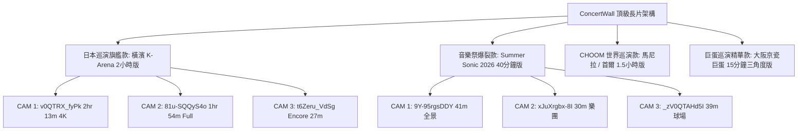

# 🎤 BABYMONSTER (베이비몬스터) 2025–2026 巡演與完整演唱會實況全覽指南
> 本指南梳理 BABYMONSTER 自 2025 年起的世界巡迴演唱會（WORLD TOUR）、特別巨蛋公演、大型戶外音樂祭實況紀錄，並標註 YouTube 上 **超過 20 分鐘至 2 小時以上** 的完整全場影片（Full Concert / Full Stage Fancam），供《Hangul PopPop》ConcertWall 多機位立體舞台牆進行精準校時與機位建置。

---

## 📌 巡演體系總覽

| 時間軸 | 巡演 / 演出名稱 | 主要涵蓋城市與標誌性場館 | YouTube 完整長片情況 |
| :--- | :--- | :--- | :--- |
| **2026 – 2027** | **2nd WORLD TOUR [춤 (CHOOM)]** | 首爾 (KSPO Dome)、馬尼拉 (MOA Arena)、大阪 (京瓷巨蛋)、曼谷、東京等 | 🟢 **有 1.5 ~ 2 小時全場錄影** (馬尼拉、首爾)；巨蛋場為精華集 |
| **2026.08** | **SUMMER SONIC 2026** | 日本千葉・ZOZO Marine Stadium (海洋球場 Marine Stage) | 🟢 **有 30 ~ 45 分鐘全開麥全場大秀** (3 機位完美連貫) |
| **2025** | **1st WORLD TOUR [HELLO MONSTERS]** | 首爾、日本橫濱 (K-Arena)、神奈川 (Pia Arena MM)、神戶、馬尼拉、台北等 | 🟢 **有 2 小時 13 分鐘 4K 超長全場錄影** (日本橫濱場) |
| **2024** | **1st Fanmeeting [SEE YOU THERE]** | 東京有明體育館、首爾慶熙大學、台北 TICC、雅加達、曼谷、新加坡 | 🟡 單曲舞台與 Fanmeeting 精華為主 (10~25分鐘) |

---

## 🌟 第一章：2026–2027 BABYMONSTER WORLD TOUR [춤 (CHOOM)]

### 1. 巡演特色與舞台架構
- **Live Band 編制升級**：全開麥搭配重金屬鼓手與電吉他，將《SHEESH》、《DRIP》、《BATTER UP》全面重音搖滾化。
- **個人 Solo 專屬舞台**：
  - **Asa** – 《Temple》（高難度快嘴饒舌與力量獨舞）
  - **Pharita** – 《Super Bass》（Nicki Minaj 經典翻唱，清甜快嘴）
  - **Ahyeon** – 《Problem》（Ariana Grande 翻唱，海豚音與轉音全開麥）
  - **Ruka** – 《Ratatata》（極限力量控制嘻哈律動）
  - **Rora** – 《Havana》（抒情浪漫靈魂唱腔）
  - **Chiquita** – 《Worth It》（性感力量舞步與忙內反差萌）
  - **Rami** – 專屬高音主唱個人秀
- **安可巡場花車 (Send-off Cart)**：成員搭乘環場小車演唱《LOVE IN MY HEART》與粉絲零距離互動。

---

### 2. 各站巡迴與 YouTube 實況長片清單

#### 📍 菲律賓・馬尼拉站 (SM Mall of Asia Arena)
- **演出日期**：2026.09.05
- **現場亮點**：全場萬人無斷點高分貝大合唱，海外應援聲量最炸裂的一場。
- **YouTube 完整長片資源**：
  - 🎬 **[1:53:01 / 1 小時 53 分鐘]** [BABYMONSTER CHOOM 2026 WORLD TOUR IN MANILA](https://www.youtube.com/watch?v=BN61wzbvI7M)
    - **影片 ID**：`BN61wzbvI7M`
    - **時長**：113 分鐘（包含開場至 Double Encore 完整收錄）
    - **畫質/音質**：1080p，音質乾淨飽滿，非常適合做全場主視角 CAM 1。

#### 📍 韓國・首爾站 (KSPO Dome 首爾奧林匹克體操館)
- **演出日期**：2026.06.26 - 2026.06.28
- **現場亮點**：CHOOM 巡演全球啟航站，最標準完整的 YG 官方舞美設計、大螢幕特效與煙火。
- **YouTube 完整長片資源**：
  - 🎬 **[1:40:55 / 1 小時 40 分鐘]** [BABYMONSTER CHOOM 2026-27 WORLD TOUR IN SEOUL](https://www.youtube.com/watch?v=A3M7Nxt3_-Q)
    - **影片 ID**：`A3M7Nxt3_-Q`
    - **時長**：100 分鐘
    - **特色**：正面看台全景，收錄全員 Solo 舞台、開場《WE GO UP》到安可謝幕。

#### 📍 日本・大阪京瓷巨蛋特別公演 (Special Live at Kyocera Dome Osaka)
- **演出日期**：2026.09.22 - 2026.09.23
- **現場規模**：BABYMONSTER 首次巨蛋公演，單場 45,000+ 人，兩天累計 90,000 名觀眾。
- **日本拍攝環境特點**：
  > ⚠️ **版權與安檢限制**：日本巨蛋有極嚴格的「撮影禁止」規定，現場安檢極密，導致 YouTube 上**沒有單一 1~2 小時不中斷的完整直拍**，但有許多 10~15 分鐘的現場精華與單曲特寫。
- **YouTube 資源**：目前沒有收錄符合條件（15 分鐘以上、連續舞台影像、可嵌入、畫質足夠）的大阪影片，已從播放牆移除。

---

## ⚡ 第二章：2025 BABYMONSTER 1st WORLD TOUR [HELLO MONSTERS]

### 1. 巡演特色與重要里程碑
- BABYMONSTER 正式出道的首次世界巡迴演唱會，在亞洲多國與北美體育館全面引發搶票熱潮。
- 確立了全開麥實力怪物女團的現場口碑，現場演繹《BATTER UP》、《SHEESH》、《LIKE THAT》、《STUCK IN THE MIDDLE》等出道初期名曲。

---

### 2. 各站巡迴與 YouTube 超長長片清單（高達 2 小時+）

#### 📍 🥇 日本・橫濱站 (K-Arena Yokohama) —— **全網最完整頂級長片！**
- **演出日期**：2025.04.13
- **場館特點**：專為音樂設計的世界最大級 2 萬人音樂專用室內場館（音場無雜音殘響）。
- **YouTube 完整長片資源**：
  - 🎬 **[2:13:49 / 2 小時 13 分 49 秒]** [BABYMONSTER 1st WORLD TOUR *HELLO MONSTERS* IN JAPAN ~2025.04.13 K-ARENA YOKOHAMA~ [4K]](https://www.youtube.com/watch?v=v0QTRX_fyPk)
    - **影片 ID**：`v0QTRX_fyPk`
    - **時長**：133 分鐘（整整 2 小時 13 分鐘，完全沒有剪輯中斷）
    - **畫質/音質**：超高清 4K，K-Arena 專用音響生嗓原音全開麥。
    - **適用性**：⭐️⭐️⭐️⭐️⭐️ **極度推薦作為 ConcertWall 核心背景長片！**

#### 📍 🥈 日本・神奈川站 (Pia Arena MM)
- **演出日期**：2025.04.12
- **YouTube 完整長片資源**：
  - 🎬 **[1:53:53 / 1 小時 53 分 53 秒]** [【Day2】BABYMONSTER 「HELLO MONSTERS」 ワールドツアー IN 神奈川 Full Video](https://www.youtube.com/watch?v=81u-SQQyS4o)
    - **影片 ID**：`81u-SQQyS4o`
    - **時長**：113 分鐘完整收錄。
  - 🎬 **[27:35]** [BABYMONSTER - 'FULL ENCORE' HELLO MONSTER WORLD TOUR KANAGAWA](https://www.youtube.com/watch?v=t6Zeru_VdSg)
    - **影片 ID**：`t6Zeru_VdSg`
    - **特色**：近半小時完整的安可大合唱互動。

---

## ☀️ 第三章：大型戶外音樂祭代表作 —— SUMMER SONIC 2026

### 📍 千葉・ZOZO Marine Stadium (東京海洋球場 Marine Stage)
- **演出日期**：2026.08.14
- **觀眾人數**：35,000+ 人（烈日酷暑下午場塞爆球場）
- **演出評價**：被日韓媒體與樂評評為「新生代女團戶外全開麥天花板」。
- **YouTube 3 機位黃金長片組合**（目前《Hangul PopPop》ConcertWall 成功運行的配置）：
  - **CAM 1 主視角**：`9Y-95rgsDDY`（**41 分 04 秒**）—— 包含 Intro、WE GO UP、CHOOM、MOON、DRIP、FOREVER、Really Like You、BATTER UP、SHEESH 之完整音樂祭全場大秀。
  - **CAM 2 搖滾區/樂團視角**：`xJuXrgbx-8I`（**29 分 48 秒**）—— 貼近樂團鼓手與成員走位的全開麥炸裂視角。
  - **CAM 3 球場全景特寫**：`_zV0QTAHd5I`（**38 分 50 秒**）—— 俯瞰 3.5 萬觀眾人海與大螢幕特寫。

---

## 🎯 第四章：ConcertWall（三機位舞台牆）最佳配置建議

為了徹底避免像先前京瓷巨蛋那樣「點選切歌會重新載入 3 分鐘獨立單曲」的碎片感，建議將 ConcertWall 預設清單升級為以下架構：

### 具體實施策略：
1. **橫濱 K-Arena（2 小時 13 分鐘）**：
   - 只要設定一套三機位（CAM 1、CAM 2、CAM 3），整場巡演 18 首歌曲全部都在長片內部跳轉時間戳記，畫面持續播放、切換歌曲如絲綢般順滑。
2. **馬尼拉 / 首爾 CHOOM 巡演（1 小時 40 分 ~ 1 小時 53 分鐘）**：
   - 同樣具備完整歌曲結構（包含 7 位成員各自的 Solo 舞台），能體驗完整的《CHOOM》巡迴演唱會。
3. **京瓷大阪巨蛋（15 分鐘現場多角度）**：
   - 剔除所有 10 秒短片與官方 MV，專注於 15 分鐘的現場舞台精華對齊。
